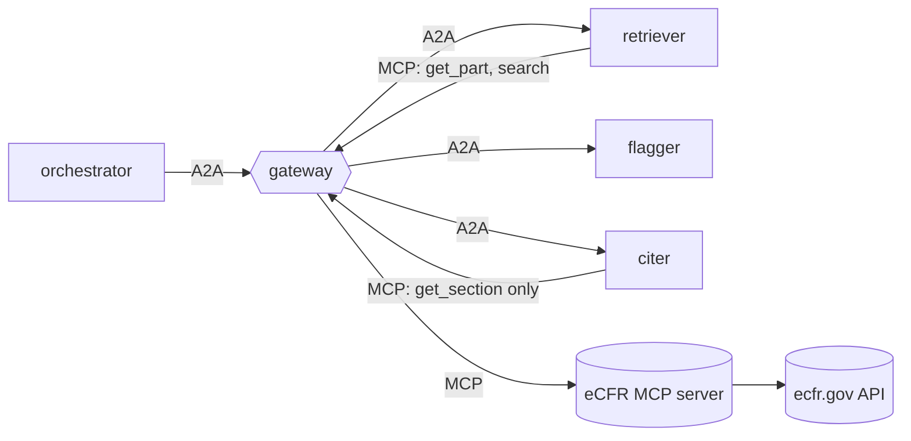

# reglab-regulatory-agents

A regulatory research agent system, evaluated against hand labels. It pulls
federal regulation text from the public **eCFR API** through an MCP server,
flags reporting requirements that look **duplicative** or **outdated**, and cites
the exact paragraph it relied on, re-reading each quote from eCFR to confirm it.

Built on [`agent-mesh-core`](../agent-mesh-core). Aimed at the Stanford RegLab
Data Scientist role: the deliverable is a *measured* result, not a demo.



| Agent | Grants (mesh.yaml) | Job |
|---|---|---|
| orchestrator | A2A to the three agents; no tools | retriever → flagger → citer |
| retriever | `ecfr: get_part, search, list_titles` | pulls the sections and paragraphs of CFR parts |
| flagger | none (any tool call is denied) | extracts reporting requirements; flags near-duplicate pairs (TF-IDF cosine) and outdated ones (fax/telex/microfiche, defunct agencies, past one-time deadlines, dated year references) |
| citer | `ecfr: get_section` only | re-fetches every cited section and keeps a flag only if its quote appears verbatim in the named paragraph |

Every flag carries its evidence: the signals that fired, the cosine score and
shared terms, the paragraph-level citation (`40 CFR 60.7(a)(1)`), an eCFR URL
and the as-of date.

## Run it

```bash
uv venv -p 3.13 && uv pip install -e ../agent-mesh-core -e '.[dev]'
.venv/bin/pytest                                  # 15 tests on synthetic eCFR fixtures

export AGENTMESH_SECRET=$(python -c "import secrets; print(secrets.token_urlsafe(48))")
.venv/bin/agentmesh up mesh.yaml &
.venv/bin/regagents review --title 40 --parts 60 --out reports/40cfr60   # writes .json + .md
.venv/bin/agentmesh audit stats audit/gateway.jsonl
```

eCFR responses are cached under `cache/ecfr/`. The text for a given date never
changes, and the API is a shared public resource.

## The evaluation (the part that matters for RegLab)

```bash
# 1. draw a stratified sample: flagged and unflagged requirements, and
#    requirement pairs above/below the duplicate threshold
.venv/bin/regagents eval sample --title 40 --parts 60 63 --per-stratum 25 --out eval/to_label.jsonl

# 2. hand-label: set "label": true/false on every line (add "notes")

# 3. score: weighted precision/recall/F1, bootstrap 95% CIs, threshold sweep
.venv/bin/regagents eval score eval/to_label.jsonl
AGENTMESH_LLM=1 .venv/bin/regagents eval score eval/to_label.jsonl --judge   # heuristic + Claude judge
```

Design choices worth explaining in an interview:

- **Stratified sampling with weights.** Unflagged requirements vastly outnumber flagged ones, so they're sampled sparsely and each label is weighted by its stratum size over the number sampled. Without this, recall would be wildly optimistic.
- **Duplicate recall is relative to a candidate pool.** Only pairs above a low similarity floor (0.30) can be labelled; pairs below it count as negatives. State this when you report the number.
- **Stratified bootstrap** for the confidence intervals, plus a **threshold sweep** for duplicates, so the reported threshold is chosen from data.
- **An optional LLM judge** (`regagents/judge.py`, Claude with structured output) confirms the heuristic's positives. The same harness scores both, so you can show whether the model earns its cost.

Nothing in `eval/` is pre-labelled. The 50–100 labels are yours to make, and
that's the point of the exercise.

## Extending

- Add signals to `src/regagents/data/outdated_signals.json` as labelling turns up new patterns, then re-score.
- `search` is granted to the retriever but unused by the default pipeline; it's the hook for "find every reporting requirement mentioning X across titles".

## Status

Tested against a synthetic fixture shaped like eCFR's versioner XML
(`tests/fixtures/part_900.xml`, labelled synthetic). The parser hasn't yet run
against live ecfr.gov output, because sandbox network access to `www.ecfr.gov`
was pending during development. Run the `review` command once to confirm.
