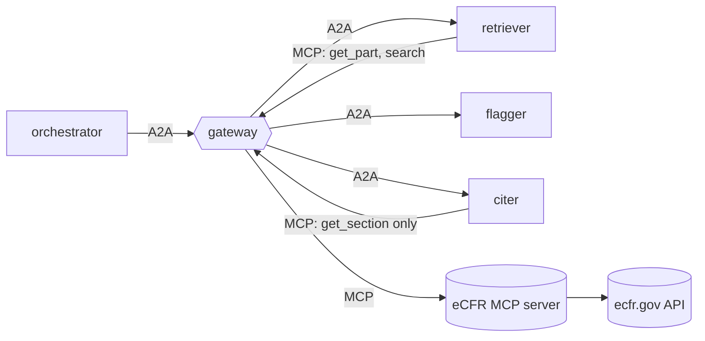

# reglab-regulatory-agents

[](https://github.com/jsdavids/reglab-regulatory-agents/actions/workflows/tests.yml)

A regulatory research agent system, evaluated against hand labels. It pulls
federal regulation text from the public **eCFR API** through an MCP server,
flags reporting requirements that look **duplicative** or **outdated**, separates true
duplicates (the same party reporting twice) from **boilerplate** repeated across
source categories, and cites
the exact paragraph it relied on, re-reading each quote from eCFR to confirm it.

Built on [`agent-mesh-core`](https://github.com/jsdavids/agent-mesh-core). Aimed at the Stanford RegLab
Data Scientist role: the deliverable is a *measured* result, not a demo.



| Agent | Grants (mesh.yaml) | Job |
|---|---|---|
| orchestrator | A2A to the three agents; no tools | retriever → flagger → citer |
| retriever | `ecfr: get_part, search, list_titles` | pulls the sections and paragraphs of CFR parts |
| flagger | none (any tool call is denied) | groups near-identical requirements (TF-IDF cosine) into **duplicates** when they can bind the same party (same subpart, or restating the General Provisions) and **boilerplate** when they repeat across subparts; flags outdated ones (fax/telex/microfiche, defunct agencies, past one-time deadlines, dated year references) |
| citer | `ecfr: get_section` only | re-fetches every cited section and keeps a flag only if its quote appears verbatim in the named paragraph |

Every flag carries its evidence: the signals that fired, the cosine score and
shared terms, the paragraph-level citation (`40 CFR 60.7(a)(1)`), an eCFR URL
and the as-of date.

## Run it

```bash
uv venv -p 3.13 && uv pip install -e '.[dev]'
# agentmesh (the shared core) installs from its v0.1.0 release on GitHub. To work on
# the core at the same time: git clone https://github.com/jsdavids/agent-mesh-core ../agent-mesh-core
#   && uv pip install -e ../agent-mesh-core
.venv/bin/pytest                                  # 28 tests on synthetic eCFR fixtures (also run in CI)

export AGENTMESH_SECRET=$(python -c "import secrets; print(secrets.token_urlsafe(48))")
.venv/bin/agentmesh up mesh.yaml &
.venv/bin/regagents review --title 40 --parts 60 --out reports/40cfr60   # writes .json + .md
.venv/bin/agentmesh audit stats audit/gateway.jsonl
```

eCFR responses are cached under `cache/ecfr/`. The text for a given date never
changes, and the API is a shared public resource.

## The evaluation (the part that matters for RegLab)

```bash
# 1. draw a stratified sample (already done: eval/to_label.jsonl, 96 items, seed 0)
.venv/bin/regagents eval sample --title 40 --parts 60 63 --date 2026-10-26 --out eval/to_label.jsonl

# 2. hand-label, following eval/LABELING.md (resumable; saves after every answer)
.venv/bin/regagents eval label eval/to_label.jsonl

# 3. score: weighted precision/recall/F1, bootstrap 95% CIs, threshold sweep
.venv/bin/regagents eval score eval/to_label.jsonl
AGENTMESH_LLM=1 .venv/bin/regagents eval score eval/to_label.jsonl --judge   # heuristic + Claude judge

# 4. agreement with a second labeller on a shared subset (Cohen's kappa)
.venv/bin/regagents eval agree eval/to_label.jsonl eval/second_labeller.jsonl
```

Three things are measured, each from its own strata:

| Item type | Question | Strata |
|---|---|---|
| `requirement` | Is this sentence a reporting/recordkeeping requirement? | kept by the extractor; dropped with only an obligation word; only a reporting word; neither |
| `outdated` | Is this requirement outdated? | flagged; not flagged |
| `duplicate` | Would one party bound by both report the same thing twice? | (seed, member) pairs the report claims; other same-scope pairs with cosine ≥ 0.30 |

Design choices worth explaining in an interview:

- **Stratified sampling with weights.** Unflagged requirements vastly outnumber flagged ones, so they're sampled sparsely and each label is weighted by its stratum size over the number sampled. Without this, recall would be wildly optimistic.
- **The extractor is measured too.** Outdated and duplicate scores only see sentences the extractor kept, so its recall caps the whole pipeline's. The two near-miss strata (one regex half matched) are where its misses concentrate.
- **Duplicate recall is relative to a candidate pool.** Only same-scope pairs above a low similarity floor (0.30) can be labelled; pairs below it count as negatives. State this when you report the number.
- **The eval scores what the report claims.** A group claims each member duplicates its seed, so the sample is drawn from those (seed, member) pairs, and the threshold sweep regroups at every threshold rather than thresholding pairs.
- **Stratified bootstrap** for the confidence intervals, plus a **threshold sweep** for duplicates, so the reported threshold is chosen from data.
- **An optional LLM judge** (`regagents/judge.py`, Claude with structured output) confirms the heuristic's positives. The same harness scores both, so you can show whether the model earns its cost.

Nothing in `eval/` is pre-labelled. The labels are yours to make, and that's
the point of the exercise. Sampling is prefix-stable: `--per-stratum 24 --carry
eval/to_label.jsonl` draws a superset and keeps your labels.

## Extending

- Add signals to `src/regagents/data/outdated_signals.json` as labelling turns up new patterns, then re-score.
- Tighten `REPORTING_RE` the same way. Every prediction is recomputed from the text at scoring time, so labels survive rule changes. A likely first fix: a bare "maintain" matches operating duties ("operate and maintain the source") as well as recordkeeping.
- `search` is granted to the retriever but unused by the default pipeline; it's the hook for "find every reporting requirement mentioning X across titles".

## Status: verified on live eCFR (40 CFR parts 60 and 63, as of 2026-10-26)

`regagents review --title 40 --parts 60 63` through the gateway: 4,303 sections,
15,400 reporting requirements; 2,067 duplicate groups, 1,196 boilerplate groups
and 457 outdated requirements found (the report shows the top 200 of each),
**every quote re-verified by the citer**, flagging in 3.3 s, gateway overhead
0.14 ms p50 / 0.18 ms p95 over 1,222 calls, audit chain intact.

Running on real regulations changed the design in four places:

- **Duplicates are scoped by who they bind.** The top "duplicate" before this change was the CEDRI/ERT electronic-reporting sentence, repeated in 105 subparts. Each subpart covers a different source category, so no single facility reports it twice. Only 7,878 of the 156,371 similar pairs (≥ 0.55) can bind the same party: same subpart, or one in the part's General Provisions. Those are `duplicate`. The rest are `boilerplate`, a harmonization question rather than redundant reporting. The largest duplicate groups are now subparts restating the General Provisions (e.g. § 63.9(k), § 63.7(e)(1)).

- **Duplicates are reported as groups, not pairs.** Boilerplate such as the force-majeure notice recurs across 40+ subparts, and part 60 alone produced 29,862 pairs. Groups form around a seed, and a member must be within the threshold of the seed itself; plain single-linkage chained 1,558 requirements into one blob.
- **Cross-references gate similarity.** "Maintain records as specified in § 60.395a" and "... § 60.5420" share every word but are different obligations. Word cosine is multiplied by the overlap of the cited sections. Citing the same section adds nothing on its own, which avoids grouping everything that delegates to one reporting section.
- **Paragraph designations come from the XML structure.** Italic `(<I>1</I>)` marks levels 4–5. Headings that run into a first child (`(b) Applicability. (1) ...`, `(h) Compliance—(1) ...`) are detected, and an ambiguous `(i)` after `(h)(5)` is resolved by looking at the next paragraph. Mislabels (a roman numeral at the top level) dropped from 280 to 5 in part 60 and from 1,756 to 171 in part 63, mostly irregular definition lists.

All-pairs similarity uses sparse matrix products (scipy), a block of rows at a
time: 2.2 s for the 15,400 requirements of parts 60 and 63, down from about
90 s in pure Python, with identical pairs (a test checks it against the
pairwise definition). Known limits: a facility can be subject to several
subparts at once (an NSPS and a NESHAP), which scoping by subpart can't see;
those overlaps show up as boilerplate. Section amendment dates exist
only for sections changed since eCFR's point-in-time history begins (2017), so
`not_amended` fires rarely.
