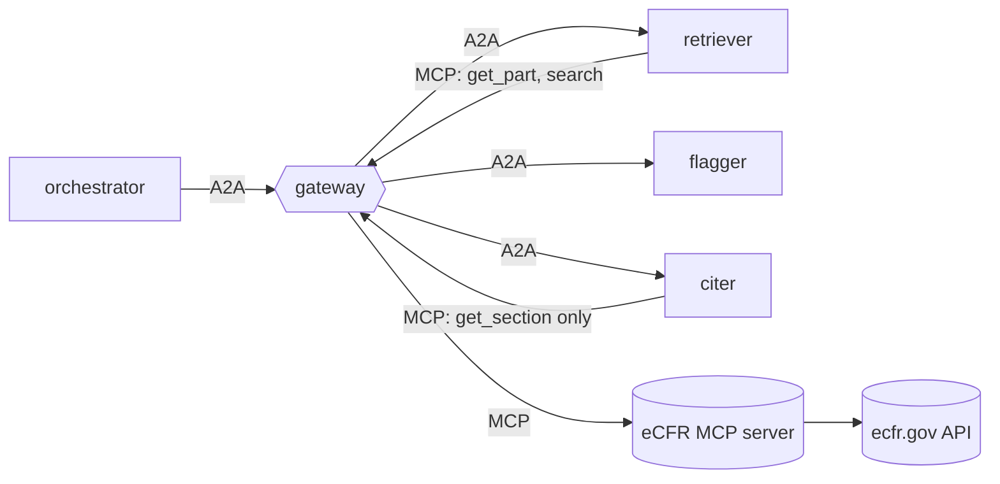

# reglab-regulatory-agents

A regulatory research agent system, evaluated against hand labels. It pulls
federal regulation text from the public **eCFR API** through an MCP server,
flags reporting requirements that look **duplicative** or **outdated**, and cites
the exact paragraph it relied on, re-reading each quote from eCFR to confirm it.

Built on [`agent-mesh-core`](https://github.com/jsdavids/agent-mesh-core). Aimed at the Stanford RegLab
Data Scientist role: the deliverable is a *measured* result, not a demo.



| Agent | Grants (mesh.yaml) | Job |
|---|---|---|
| orchestrator | A2A to the three agents; no tools | retriever → flagger → citer |
| retriever | `ecfr: get_part, search, list_titles` | pulls the sections and paragraphs of CFR parts |
| flagger | none (any tool call is denied) | extracts reporting requirements; flags near-duplicate pairs (TF-IDF cosine) and outdated ones (fax/telex/microfiche, defunct agencies, past one-time deadlines, dated year references) |
| citer | `ecfr: get_section` only | re-fetches every cited section and keeps a flag only if its quote appears verbatim in the named paragraph |

Every flag carries its evidence: the signals that fired, the cosine score and
shared terms, the paragraph-level citation (`40 CFR 60.7(a)(1)`), an eCFR URL
and the as-of date.

## Run it

```bash
uv venv -p 3.13 && uv pip install -e '.[dev]'
# agentmesh (the shared core) installs from its v0.1.0 release on GitHub. To work on
# the core at the same time: git clone https://github.com/jsdavids/agent-mesh-core ../agent-mesh-core
#   && uv pip install -e ../agent-mesh-core
.venv/bin/pytest                                  # 20 tests on synthetic eCFR fixtures

export AGENTMESH_SECRET=$(python -c "import secrets; print(secrets.token_urlsafe(48))")
.venv/bin/agentmesh up mesh.yaml &
.venv/bin/regagents review --title 40 --parts 60 --out reports/40cfr60   # writes .json + .md
.venv/bin/agentmesh audit stats audit/gateway.jsonl
```

eCFR responses are cached under `cache/ecfr/`. The text for a given date never
changes, and the API is a shared public resource.

## The evaluation (the part that matters for RegLab)

```bash
# 1. draw a stratified sample: flagged and unflagged requirements, and
#    requirement pairs above/below the duplicate threshold
.venv/bin/regagents eval sample --title 40 --parts 60 63 --per-stratum 25 --out eval/to_label.jsonl

# 2. hand-label: set "label": true/false on every line (add "notes")

# 3. score: weighted precision/recall/F1, bootstrap 95% CIs, threshold sweep
.venv/bin/regagents eval score eval/to_label.jsonl
AGENTMESH_LLM=1 .venv/bin/regagents eval score eval/to_label.jsonl --judge   # heuristic + Claude judge
```

Design choices worth explaining in an interview:

- **Stratified sampling with weights.** Unflagged requirements vastly outnumber flagged ones, so they're sampled sparsely and each label is weighted by its stratum size over the number sampled. Without this, recall would be wildly optimistic.
- **Duplicate recall is relative to a candidate pool.** Only pairs above a low similarity floor (0.30) can be labelled; pairs below it count as negatives. State this when you report the number.
- **Stratified bootstrap** for the confidence intervals, plus a **threshold sweep** for duplicates, so the reported threshold is chosen from data.
- **An optional LLM judge** (`regagents/judge.py`, Claude with structured output) confirms the heuristic's positives. The same harness scores both, so you can show whether the model earns its cost.

Nothing in `eval/` is pre-labelled. The 50–100 labels are yours to make, and
that's the point of the exercise.

## Extending

- Add signals to `src/regagents/data/outdated_signals.json` as labelling turns up new patterns, then re-score.
- `search` is granted to the retriever but unused by the default pipeline; it's the hook for "find every reporting requirement mentioning X across titles".

## Status: verified on live eCFR (40 CFR parts 60 and 63, as of 2026-10-26)

`regagents review --title 40 --parts 60 63` through the gateway: 4,303 sections,
15,400 reporting requirements, 200 duplicate groups and 200 outdated flags (the
default cap is per type), **every quote re-verified by the citer**, gateway
overhead 0.14 ms p50 / 0.21 ms p95 over 1,128 calls, audit chain intact.

Running on real regulations changed the design in three places:

- **Duplicates are reported as groups, not pairs.** Boilerplate such as the force-majeure notice recurs across 40+ subparts, and part 60 alone produced 29,862 pairs. Groups form around a seed, and a member must be within the threshold of the seed itself; plain single-linkage chained 1,558 requirements into one blob.
- **Cross-references gate similarity.** "Maintain records as specified in § 60.395a" and "... § 60.5420" share every word but are different obligations. Word cosine is multiplied by the overlap of the cited sections. Citing the same section adds nothing on its own, which avoids grouping everything that delegates to one reporting section.
- **Paragraph designations come from the XML structure.** Italic `(<I>1</I>)` marks levels 4–5. Headings that run into a first child (`(b) Applicability. (1) ...`, `(h) Compliance—(1) ...`) are detected, and an ambiguous `(i)` after `(h)(5)` is resolved by looking at the next paragraph. Mislabels (a roman numeral at the top level) dropped from 280 to 5 in part 60 and from 1,756 to 171 in part 63, mostly irregular definition lists.

Known limits: the all-pairs similarity is pure Python (about 9 s for part 60's
4,754 requirements, about 90 s for parts 60 and 63 together); an inverted index
or scikit-learn would cut that substantially. Section amendment dates exist
only for sections changed since eCFR's point-in-time history begins (2017), so
`not_amended` fires rarely.
